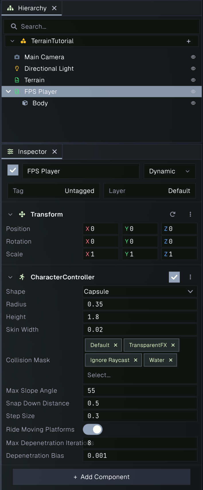
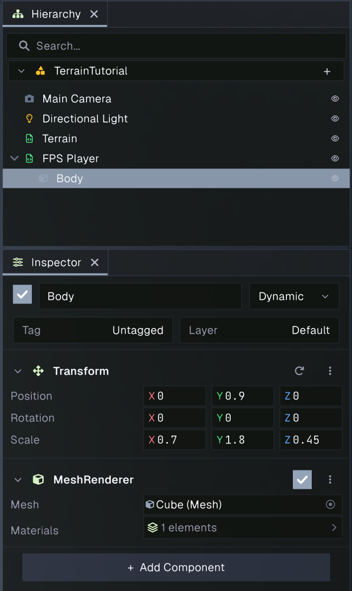
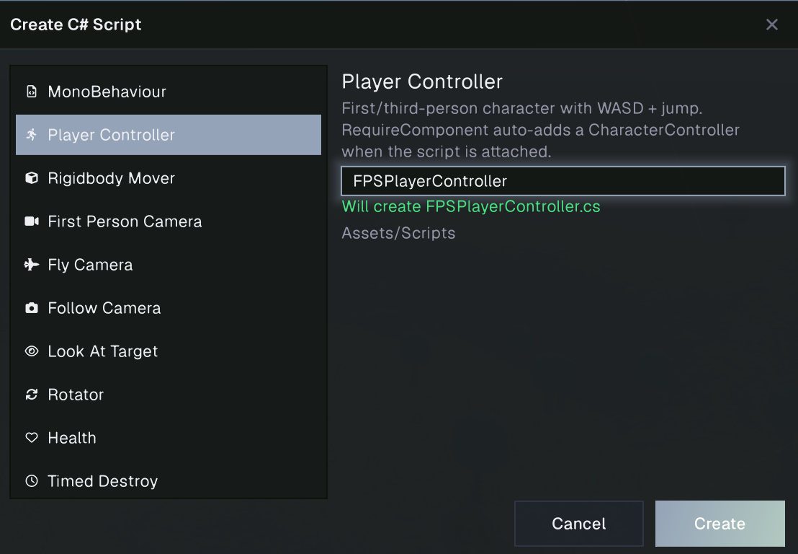
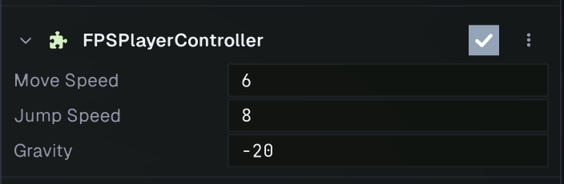
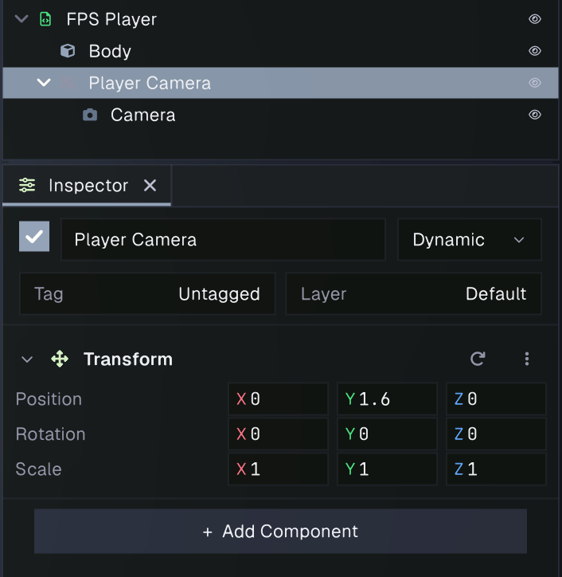
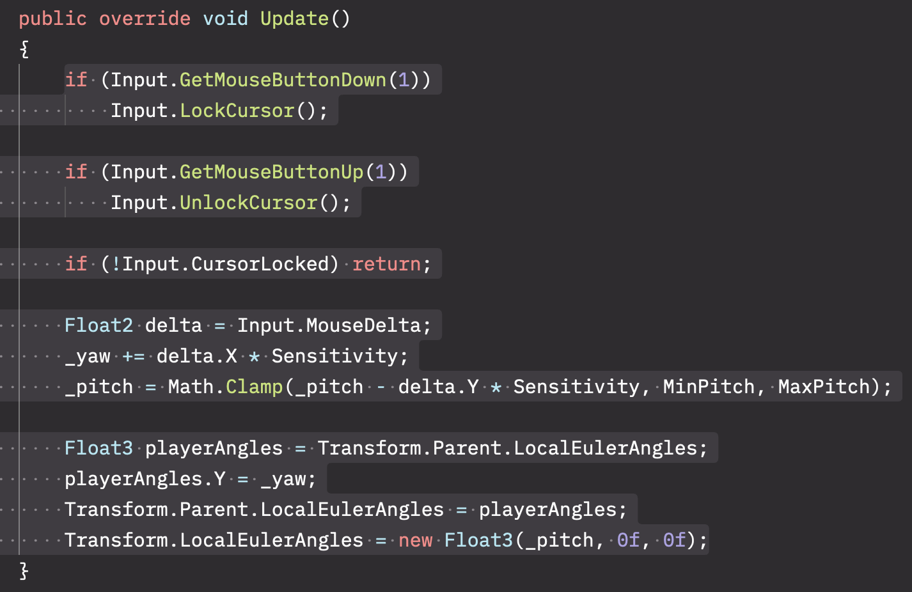
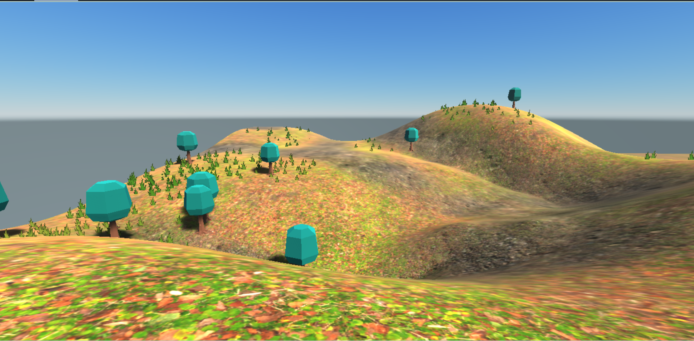

# Character Controller: Build an FPS Player Prefab

In this tutorial, you’ll make a simple first-person player from a scaled cube, Prowl’s **Character Controller**, and a camera. You’ll use the built-in **Player Controller** and **First Person Camera** script templates, save the hierarchy as a prefab, and place an instance in the terrain scene from the [terrain tutorial](terrain-tutorial.md).

## What you’ll need

Use the project where you completed the terrain tutorial. Save the terrain scene if it is not already saved. The tutorial uses its `MeadowTerrain` project assets and scene; no character model or other downloads are needed.

## 1. Create the player body

1. Open the terrain scene and choose **GameObject > Empty Object**. Rename the new object `FPS Player`.
2. With `FPS Player` selected, choose **GameObject > 3D Object > Cube**. The cube is created as a child. Rename it `Body`.
3. Set the Body’s local **Position** to `(0, 0.9, 0)` and **Scale** to `(0.7, 1.8, 0.45)`. This makes a simple visible torso centered over the player’s feet.
4. Select `FPS Player` in the Hierarchy. In the Inspector, add the **Character Controller** component. Set **Shape** to **Capsule**, **Radius** to `0.35`, and **Height** to `1.8`.

The controller’s GameObject position marks the character’s feet. Keep `FPS Player` at ground level when placing it; the Body is raised as a child so it sits above the ground.





## 2. Add first-person movement

1. In the Project panel, open a scripts folder under `Assets` (create one named `Scripts` if needed), then create a new C# script.
2. In the script creation dialog, choose the **Player Controller** template and name the class `FPSPlayerController`.
   
3. Open the generated script and save it. It uses **WASD** to move relative to the player’s facing direction and **Space** to jump. The `[RequireComponent]` attribute ensures the Character Controller component is present on the same GameObject.
4. Add `FPSPlayerController` to the `FPS Player` root. If it is not available in the component search yet, wait for script compilation to finish and try again.
   

## 3. Add the first-person camera

1. Select `FPS Player` and choose **GameObject > Empty Child**. Rename the child `Player Camera`.
2. Set the camera child’s local **Position** to `(0, 1.6, 0)`, leaving its rotation at `(0, 0, 0)`.
3. Add a **Camera** component to `Player Camera`. Make sure the camera's position is at `(0, 0, 0)`.
   
4. Create another C# script named `FPSMouseLook` using the **First Person Camera** template, then add it to `Player Camera`.
5. Open `FPSMouseLook`. First, change `Start` so yaw begins from the `FPS Player` parent and pitch from the camera:

   ```csharp
   public override void Start()
   {
       _yaw = Transform.Parent.LocalEulerAngles.Y;
       _pitch = Transform.LocalEulerAngles.X;
   }
   ```

6. Replace the code in the `Update` function body with the following:

   ```csharp
   if (Input.GetMouseButtonDown(1))
      Input.LockCursor();

  if (Input.GetMouseButtonUp(1))
      Input.UnlockCursor();

  if (!Input.CursorLocked) return;

  Float2 delta = Input.MouseDelta;
  _yaw += delta.X * Sensitivity;
  _pitch = Math.Clamp(_pitch - delta.Y * Sensitivity, MinPitch, MaxPitch);

  Float3 playerAngles = Transform.Parent.LocalEulerAngles;
  playerAngles.Y = _yaw;
  Transform.Parent.LocalEulerAngles = playerAngles;
  Transform.LocalEulerAngles = new Float3(_pitch, 0f, 0f);
   ```

   

   This applies yaw to the `FPS Player` root, which is the direction the movement script uses, and keeps up/down pitch on the camera child.
   

The camera script rotates the view with the mouse while the cursor is locked. Holding the right mouse button locks the cursor and releasing it unlocks the cursor. Yaw turns the player and camera together; pitch looks up and down without tilting the movement direction.

## 4. Save the player as a prefab

1. In the Project panel, create `Assets/Prefabs` if needed.
2. Drag the `FPS Player` root from the Hierarchy into `Assets/Prefabs`. Prowl creates a prefab containing the root, Body, Player Camera, components, and scripts.
3. Rename the prefab asset `FPSPlayer` if needed.
4. Keep the source player in the terrain scene for the first test. Later, you can remove it and add another instance by dragging `FPSPlayer` from the Project panel into any scene.

## 5. Place the player and try the terrain

1. In the terrain scene, select `FPS Player`. Set its world **Position** to a clear, level spot on the terrain. Start just above the surface if needed; the controller will settle onto walkable ground.
2. Make sure the scene has a **Terrain Collider** on its Terrain GameObject. The terrain tutorial adds one when it creates the terrain.
3. Save the scene and enter **Play** mode.
4. Click inside the **Game View** to focus it, then hold the **right mouse button** to lock the cursor and look around. Use **W**, **A**, **S**, and **D** to walk, and **Space** to jump. Release the right mouse button to unlock the cursor. Press **Escape** to release it if needed.
5. Walk around the clearing, path, hills, grass, and trees. If the view starts inside the Body, adjust the camera child’s local height or move the player to an open spot.
6. Stop Play mode when you’re done. Save the scene to keep the player instance and its position.



## Troubleshooting

- If the player falls through the terrain, confirm the Terrain GameObject has a **Terrain Collider** and that its **Terrain Data** field is assigned.
- If WASD moves in an unexpected direction, rotate the `FPS Player` root to face the way you want before saving the prefab.
- If mouse look does not respond, make sure the Game View has focus and that you added the right-button lock code to `FPSMouseLook`. The First Person Camera template only reads mouse movement while the cursor is locked.
- If the camera is blocked by the Body, lower the Body’s height or move the camera child slightly forward.

## What you learned

Prowl’s Character Controller moves a kinematic character through colliders, while a script supplies movement and gravity. A camera child provides a first-person view, and saving the whole hierarchy as a prefab lets you reuse the player across scenes. For more details on creating prefab assets, see [Project panel](../editor/project.md) and [Hierarchy](../editor/hierarchy.md).
